<div align="center">

# KBC Outcome Engine

### From *"I'm thinking about it"* to *"it's done"*, even when life gets in the way.

Kate notices a life moment, asks before assuming, and turns it into one step-by-step plan across KBC and its partners.<br>
The customer approves every step and every piece of data shared. When reality breaks the plan, the engine rebuilds it.

<br>

<a href="https://hackathon2026finals.vercel.app/"></a>

<br><br>

<a href="https://hackathon2026finals.vercel.app/">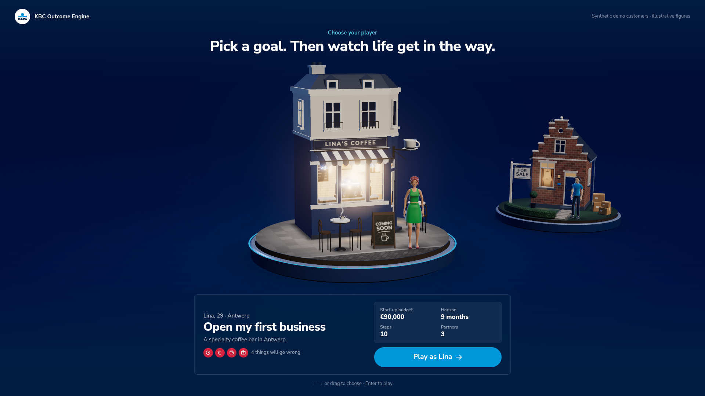</a>

<sub><b>The website opens on a 3D "choose your player" stage.</b> Pick Lina (first business) or Thomas (first home), press Enter, and the camera dives through the lit window into KBC Mobile.</sub>

<br><br>


<sub>Built for the KBC challenge at the Tectonic Hackathon 2026 finals (Gent, 20 October 2026).</sub>

</div>

---

> [!TIP]
> **Try it in 60 seconds:** open **[hackathon2026finals.vercel.app](https://hackathon2026finals.vercel.app/)** on a laptop, full screen.
> Press **Enter** to play as Lina, keep pressing **Enter** to go forward, and watch the coffee bar build itself on the left while the engine works on the right.
> Press **C** to come back and play Thomas, or **3** for "your own" customer. No account, no setup.

## Contents

1. [The problem](#1-the-problem)
2. [Our solution](#2-our-solution)
3. [**The website: a guided tour**](#3-the-website-a-guided-tour)
4. [Everything we built](#4-everything-we-built)
5. [The backend: how the engine thinks](#5-the-backend-how-the-engine-thinks)
6. [The prediction model](#6-the-prediction-model)
7. [Data, privacy and security](#7-data-privacy-and-security)
8. [Run it locally](#8-run-it-locally)
9. [Repository map](#9-repository-map)
10. [Status and team](#10-status-and-team)

---

## 1. The problem

KBC already offers **229 products and services across 21 ecosystems** (Housing, Energy, Mobility, Business…), with **28 partners** such as Immoscoop, Setle, Impact us today, Cambio and Billit. That is the catalogue KBC gave us in [`resources/KBC_Ecosystems.xlsx`](resources/KBC_Ecosystems.xlsx).

For a customer, it is still **a catalogue**. They have to know what to look for, in which order, and from whom. So the intent (*"I'm buying a house"*, *"I'm opening my own business"*) rarely turns into action.

The challenge question: ***how can KBC help customers reach important goals before they realise they need help?***

Buying a house shows the gap well (sources in [`docs/assumptions.md`](docs/assumptions.md)):

| | |
|---|---|
| **66%** | of Flemish homes were built before 1981 |
| **~€48k** | is the average renovation simulated with Setle |
| **71%** | of Belgians don't know which grants exist |

And even a perfect plan breaks: a quote comes in too high, a contractor is late, a job is lost. Today, the customer is alone at that moment too.

**What KBC already has** (verified): the MyHome dashboard (March 2026), Immoscoop inside KBC Mobile, and the KBC × Immoscoop feasibility certificate. These are toolboxes.

> **But do customers even know about them, and do they really use them?**

A toolbox only helps people who already know what to look for. Nobody yet **detects** the moment, **sequences** the steps across ecosystems, and **keeps the plan alive** when things go wrong. That is our gap. Details in [`SOLUTION.md`](SOLUTION.md#differentiation).

## 2. Our solution

**The KBC Outcome Engine** is one generic pipeline that takes a customer from intent to a measurable outcome, and replans when reality changes.

<p align="center">
  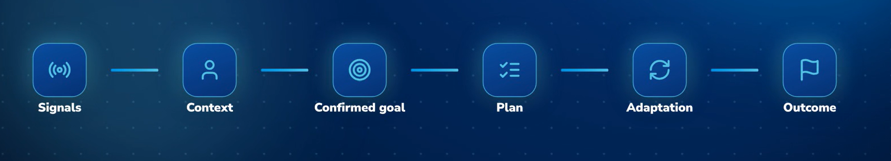
</p>

| Step | What happens |
|---|---|
| **Signals** | Only facts KBC can plausibly see: transactions, products held, and behaviour **inside** KBC Mobile (page views, loan simulations, questions to Kate). 39 signal rules with decay and saturation. |
| **Context** | Who the customer is today (household, income, savings, debt, housing, products held), plus the life moments a trained model detects: buying a home, starting a business, new parent, electric car, retirement. |
| **Confirmed goal** | Kate does **nothing**, **asks**, or **suggests**, and always says why. Doing nothing is a real option. The goal only exists once the customer confirms it, with their own limits (budget, monthly cost, deadline). |
| **Plan** | A journey composed from the real KBC catalogue: 24 capabilities served by 35 catalogue items (KBC + partners), ordered by dependencies, checked against the customer's limits. The customer accepts or skips each step and chooses, per partner and per field, what is shared. Nothing is shared by default. |
| **Adaptation** | When something breaks the plan (income drop, quote overrun, partner delay), the engine finds what broke, replans, scores the options and offers costed scenarios. Kate recommends; the customer decides. |
| **Outcome** | A triple-win summary: what the customer, KBC and the partners each gain (estimates, labelled as such). |

**Three principles behind it:**
- **Proactive but polite.** Below a confidence threshold, Kate asks instead of assuming. *"Kate will never implement anything without explicit customer approval"*, as KBC itself puts it.
- **Explainable.** Every suggestion comes with a *"Why am I seeing this?"* built from the model's own top contributions. **No language model decides anything.**
- **Scalable by data.** Two goals run on the **same code**: *buying and renovating a home* and *starting a business*. A new goal means new rows (capabilities, template steps), not new code.

---

## 3. The website: a guided tour

> **Live:** **[hackathon2026finals.vercel.app](https://hackathon2026finals.vercel.app/)** · best on a laptop or projector at full screen (on a phone, the app runs full screen without the 3D stage).

The site is built as **a stage for a pitch**: a real-size KBC Mobile phone in the centre, a **3D diorama that builds itself** on the left, and the **engine's live HUD** on the right. Everything you see in the phone comes from the backend engine; if the network fails, a local engine takes over without a visible break.

### ① Choose your player


- A **3D cover-flow** of miniature life scenes (three.js, procedural geometry): **Lina, 29**, opening a specialty coffee bar in Antwerp, and **Thomas, 30**, buying a 1970s house in Gent. Rigged, animated people (CC0) wave when they are in focus.
- Each card shows the goal, budget, horizon, number of steps and partners, and **the surprises waiting ahead**.
- **Play** and the camera **dives into the lit window**; the window light morphs into the phone screen. About 1.7 s from Enter to KBC Mobile.
- A third slot, **"Your own"**, opens the model playground (see ⑧).
- Drag, click, arrow keys or `1` / `2` / `3`. Without WebGL, or with `?q=low`, a 2D picker takes over.

### ② Kate notices

<table><tr>
<td width="50%">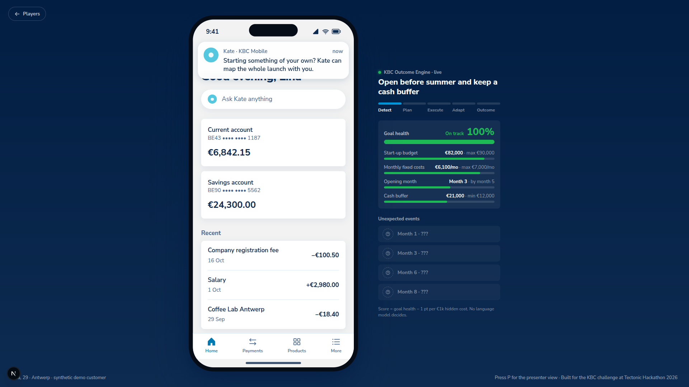</td>
<td width="50%"></td>
</tr><tr>
<td><b>A discreet notification</b> on a normal KBC Mobile home screen. It never blocks the app: tap outside or press Esc and it becomes a small Kate pill.</td>
<td><b>Kate asks before assuming.</b> One observed fact, one question. <i>"Why am I seeing this?"</i> lists the signals. <b>Not now</b> → nothing is built, nothing is shared.</td>
</tr></table>

### ③ Build the plan, and watch it being built

<table><tr>
<td width="62%">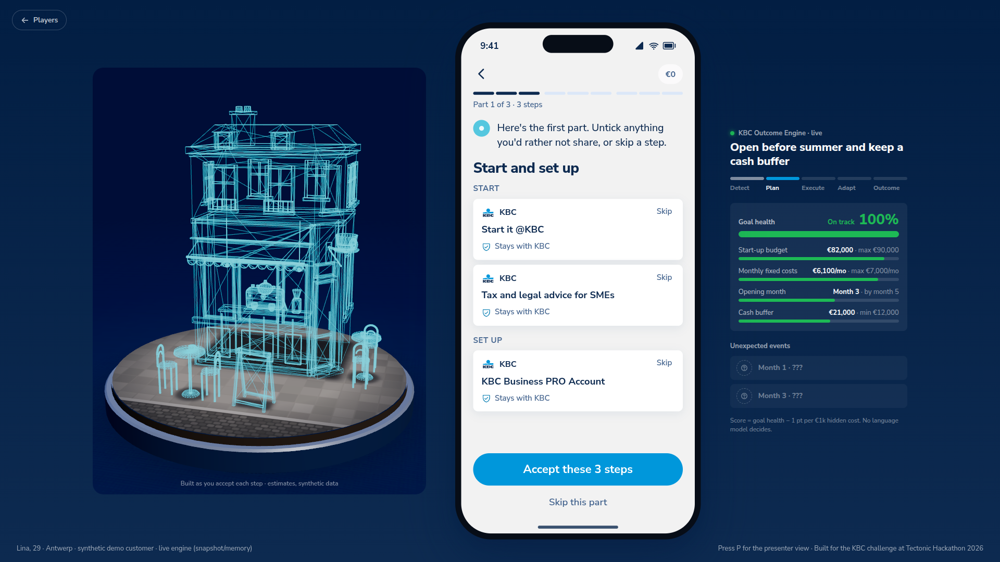</td>
<td>

- The path is split into **3–4 parts** (e.g. *Start and set up · Get paid · Protect*), each a page of compact step cards.
- Each card shows **KBC or the partner's name + its ecosystem**, the outcome, and the **data shared as chips you can untick**. "Stays with KBC" when nothing leaves the bank.
- **Skip** any card, or **Accept these N steps** in one tap.
- On the left, the diorama starts as a **cyan scaffold**. Each accepted step **drops its piece in** with a bounce and a puff of dust. A skipped step stays a ghost outline.
- An **ecosystem strip** shows the whole cast: *KBC + 4 partners · Housing · Energy and sustainability*.

</td>
</tr></table>

### ④ Life gets in the way

<table><tr>
<td width="62%">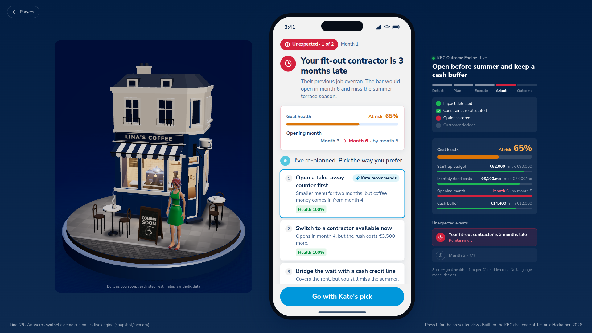</td>
<td>

The plan goes live, chapter by chapter, and **two surprises hit each player**:

| Lina | Thomas |
|---|---|
| Fit-out contractor 3 months late | Renovation quote overrun |
| Equipment cost overrun | Job loss, told to Kate |

For each one, the engine **detects the impact**, shows **what broke** (before → after → limit), **recalculates**, and **scores every option**. Kate recommends one; the customer picks any. The building flashes red and sags where it hurts, then **repairs** when the choice is made.

</td>
</tr></table>

The **engine HUD** on the right follows every stage live: *Detect → Plan → Execute → Adapt → Outcome*, the goal health, the four constraint gauges (budget, monthly cost, deadline, buffer) and the surprise slots, *"???"* until they hit.

### ⑤ The plan held: triple win

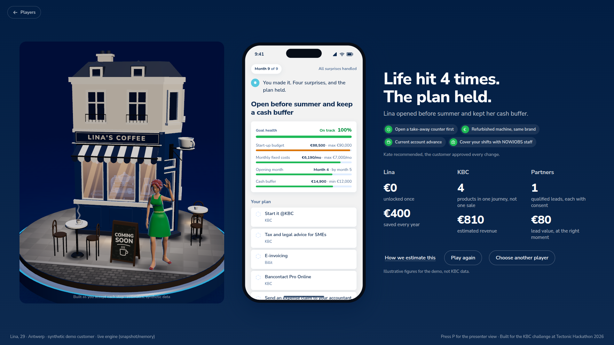

The building turns to face you and lights up, the person cheers, and the stage shows **what each side gained**: the customer (€ saved or unlocked, kWh, CO₂), KBC (products in one journey, revenue) and partners (qualified leads, **each with consent**). *"How we estimate this"* explains every figure; all figures are labelled as estimates.

### ⑥ Your own customer: watch the model change its mind

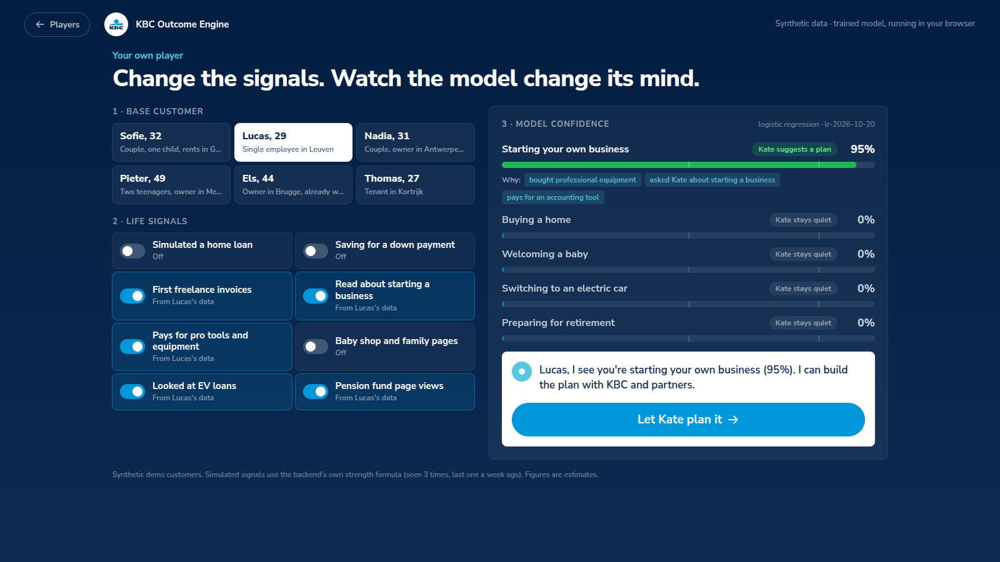

- Pick one of the **6 synthetic bank customers** (Sofie, Lucas, Nadia, Pieter, Els, Thomas).
- Switch **8 life signals** on and off (*simulated a home loan*, *first freelance invoices*, *baby shop pages*…). Each one maps to real signal codes, no invented features.
- The **trained model runs in your browser**: confidence bars per life moment, the 50% "ask" and 85% "suggest" thresholds, the *why* chips, and Kate's decision update instantly.
- **Let Kate plan it** sends the customer to the backend, which builds the real plan, then the phone flow continues.

### ⑦ Built for a live pitch

| Feature | What it does |
|---|---|
| **Presenter panel** (`P`) | Overlay with the weighted signals, confidence vs threshold, the catalogue item of each step and the raw scoreboard. `W` switches to weak signals: Kate stays silent. |
| **Keyboard flow** | `→`/`Enter` next · `←` back · `S` skip · `F` fill the plan · `1–4` pick an option · `Esc` dismiss Kate · `R` restart · `C` players |
| **Deep links** | `/?player=house\|business`, `/?demo=intent`, `/?demo=step&n=6`, `/?demo=live`, `/?demo=event&n=2`, `/?demo=finale`, `/?demo=weak` |
| **Never breaks on stage** | API down → local engine. No WebGL, lost GPU context or small screen → 2D picker, no build stage. Weak laptop → `?bloom=0` or `?q=auto`. The footer says whether a screen comes from the **live engine** or the **offline engine**. |
| **Performance** | 3D stage measured at 52–60 fps at 1080p on an Intel Iris Xe (bloom + MSAA by default), ~118 draw calls, 38k triangles. |
| **KBC look and voice** | KBC Design Language tokens read from kbc.be, the KBC logo, Nunito Sans as the free stand-in for Museo Sans, Kate's short reassuring tone. Reduced-motion support, focus rings, 48 px targets, modal sheets that trap focus. |

<details>
<summary><b>More screenshots</b> (Thomas's house, partial build, presenter overlay, 3D dive)</summary>
<br>
<table><tr>
<td>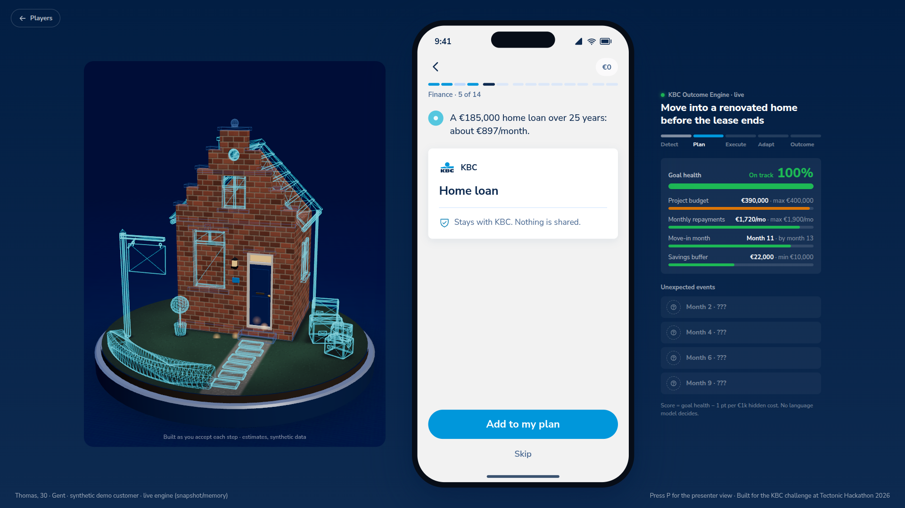</td>
<td>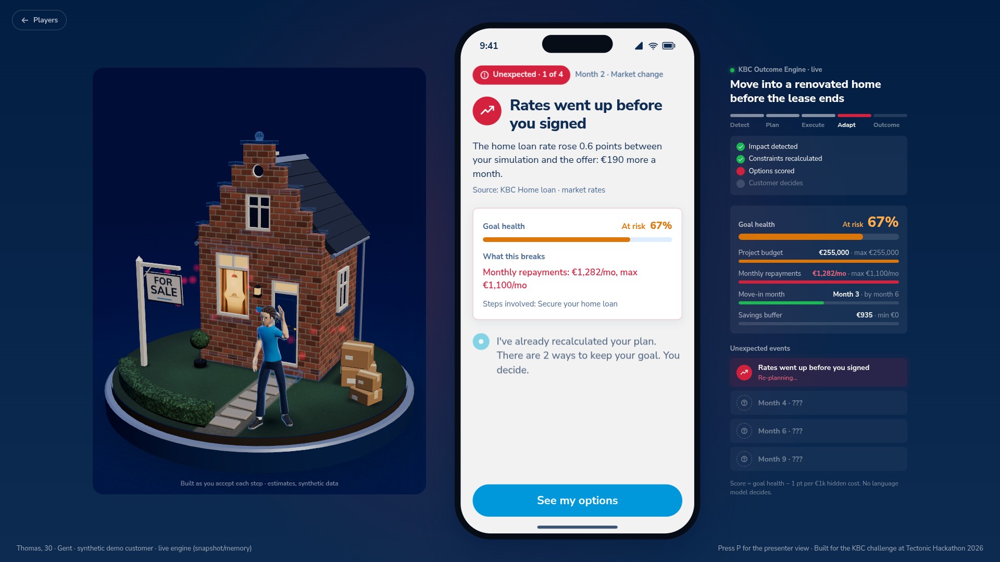</td>
</tr><tr>
<td>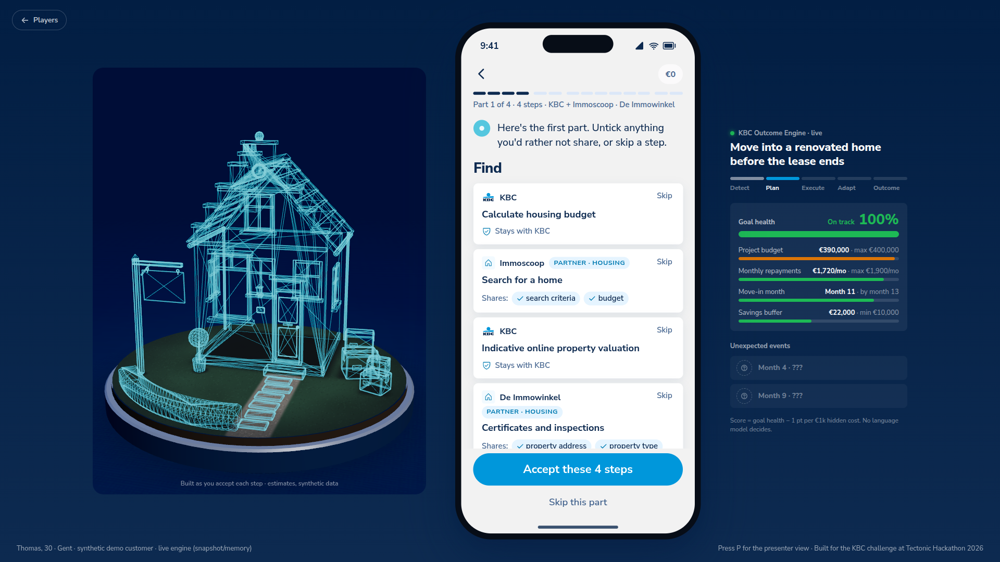</td>
<td>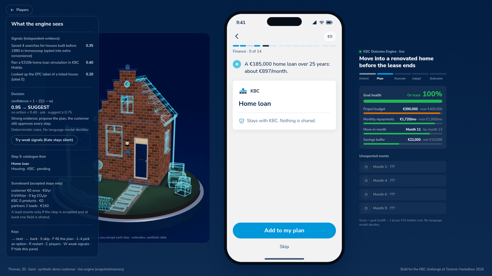</td>
</tr><tr>
<td></td>
<td>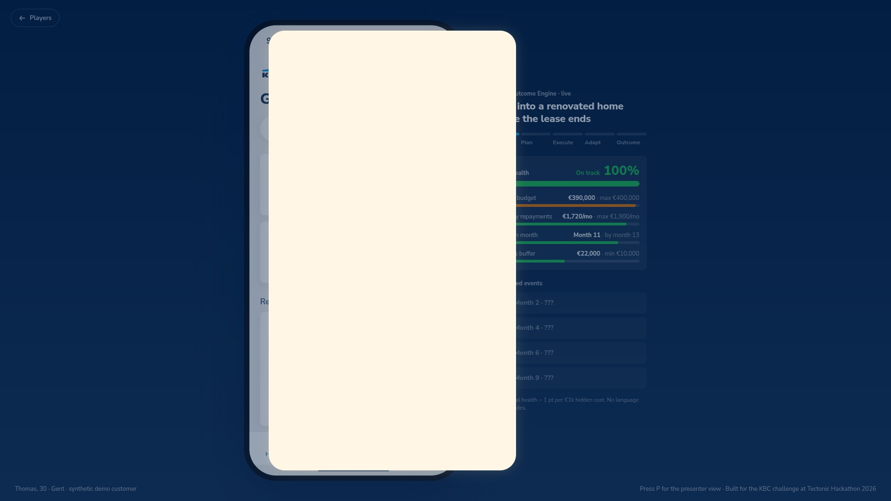</td>
</tr></table>
</details>

---

## 4. Everything we built

| Area | What is implemented | Where |
|---|---|---|
| **3D player picker** | Cover-flow of procedural dioramas, CC0 animated people, camera dive into the window, measured hand-off to the phone, 2D fallback, quality switches | [`web/src/components/picker/`](web/src/components/picker/) · [doc](docs/features/persona-picker-3d.md) |
| **3D build stage** | The player's diorama builds one piece per accepted step, ghosts skipped steps, cracks on a surprise, repairs on the choice, lights up at the finale | [`web/src/components/build/`](web/src/components/build/) · [doc](docs/features/build-stage-3d.md) |
| **KBC Mobile journey** | Home + Kate notification, intent question, path, grouped step pages with consent chips, plan, chapter pages, surprise pages, triple-win finale | [`web/src/components/journey/`](web/src/components/journey/) · [doc](docs/features/ux-redesign.md), [doc](docs/features/demo-v2-steps.md) |
| **Engine HUD** | Live pipeline stage, goal health, 4 constraint gauges, surprise slots, scoring formula on screen | [`EngineHud.tsx`](web/src/components/journey/EngineHud.tsx) · [doc](docs/features/outcome-engine.md) |
| **"Your own" player** | 6 base customers × 8 life-signal switches, client-side model, live decision, hand-off to a backend plan | [`web/src/components/custom/`](web/src/components/custom/) · [doc](docs/features/custom-player.md) |
| **Synthetic bank** | 2,000 customers, 6 months of transactions, loans, products, children, in-app events; 6 demo personas | [`scripts/bank_data/`](scripts/bank_data/) · [doc](docs/features/bank-data.md) |
| **Signals and context** (T1) | Events → 39 signal rules (decay, saturation) → persistent customer context | [`engine/signals.ts`](web/src/backend/engine/signals.ts), [`context.ts`](web/src/backend/engine/context.ts) |
| **Moment model** (T2) | One logistic regression per life moment, trained with scikit-learn, explained per feature | [`engine/model.ts`](web/src/backend/engine/model.ts) · [doc](docs/features/prediction-model.md) |
| **Intents and decision gate** (T3) | Moments → intents → NO_ACTION / WAIT / ASK / SUGGEST, with a why and a why-not for each | [`engine/decision.ts`](web/src/backend/engine/decision.ts) · [doc](docs/features/backend-t3-decision.md) |
| **Capability registry** (T4) | 24 capabilities, 35 catalogue items as providers, goal templates (home: 14 steps, business: 9) | [`engine/registry.ts`](web/src/backend/engine/registry.ts) · [doc](docs/features/backend-t4-registry.md) |
| **Orchestrator, consent, tracker** (T5) | Plan building, affordability (annuity), suppression rules, append-only consent ledger, triple-win tracker | [`engine/orchestrator.ts`](web/src/backend/engine/orchestrator.ts) · [doc](docs/features/backend-t5-orchestrator.md) |
| **Disruption and replanning** (T6) | Detect → impact → 7 replanning strategies → 2 scored scenarios → customer choice → new plan version; what-if simulation; multi-goal arbitration | [`engine/replan.ts`](web/src/backend/engine/replan.ts) · [doc](docs/features/backend-t6-replanning.md) |
| **Data layer and API** (T7) | Supabase loaders, offline snapshot, runtime repo (Supabase or memory), 13 zod-validated routes | [`web/src/app/api/`](web/src/app/api/) · [doc](docs/features/backend-t7-data-pipeline.md) |
| **Kate** (T8) | Proactive message, pre-filled goal set-up, scenario choice, grounded plan Q&A with an optional LLM that only rephrases | [`engine/kate/`](web/src/backend/engine/kate/) · [doc](docs/features/backend-t8-kate.md) |
| **Security** | RLS everywhere, strict CSP and headers, rate limits, Aikido finding resolved | [doc](docs/features/security.md) |

---

## 5. The backend: how the engine thinks

The backend is a **pure, deterministic TypeScript pipeline** (`web/src/backend/`) behind a small Next.js API. Every stage reads its **rules from the database**, so a new goal is new rows, not new code. Full design: [`backend/backend.md`](backend/backend.md).

```text
              FACTS (Supabase, read-only)
  customers · employment · housing · properties · accounts
  loans · product_holdings · transactions · app_events
                        │
                        ▼
  ① EVENTS ──► ② SIGNALS ──► ③ CONTEXT ──► ④ MOMENTS (ML) ──► ⑤ INTENTS
                                                                   │
                                                                   ▼
                                       ⑥ DECISION GATE  NO_ACTION · WAIT · ASK · SUGGEST
                                                                   │
                                                                   ▼
                                       ⑦ GOAL CONFIRMATION ◄──── KATE "Are you planning to buy a home?"
                                                                   │
                                                                   ▼
                     ⑧ CAPABILITY ORCHESTRATOR ◄── capability registry (KBC + partner catalogue)
                                                                   │
                                                                   ▼
                     ⑨ DECISION & SUPPRESSION RULES (already held, cashflow…)
                                                                   │
                                                                   ▼
                     ⑩ CUSTOMER CONTROL & CONSENT ◄──── KATE (plan Q&A)
                                                                   │
                                                                   ▼
                     ⑪ EXECUTION + OUTCOME TRACKER ──► triple win
                                                                   │
                       new facts: disruption detected              │
                     ┌─────────────────────────────────────────────┘
                     ▼
                     ⑫ DISRUPTION → IMPACT → REPLAN → SCENARIOS A/B ──► KATE ──► customer picks
                     └────────────────────► back to ⑧ with the new constraints
```

### Stage by stage

| # | Stage | What it does | Example (Sofie, the home-buying persona) |
|---|---|---|---|
| ①–② | **Events → signals** | Raw facts become interpreted signals with a strength, a time window and a decay. Repeats saturate. | 4 home-loan simulations (€243k–€476k) → `MORTGAGE_SIMULATION` |
| ③ | **Context** | Combinable attributes: age, household, income, savings, debt ratio, housing, products held, cashflow pressure. | tenant, €31k savings, debt ratio low |
| ④ | **Moments** | The ML model scores each life moment; a rules fallback runs if weights are missing. Every score carries its top contributions. | `HOME_BUYING` high |
| ⑤–⑥ | **Intents → decision** | One moment yields several intents. Gates on refusals, snoozes, thresholds and cashflow decide whether Kate speaks, and give one message at a time. | BUY_HOME → **ASK** (84%): *"You ran 4 home-loan simulations"*. Income drop → **WAIT** |
| ⑦ | **Goal confirmation** | Kate turns the intent into a goal with constraints, pre-filled and capped by affordability. | budget capped at €1,100/month |
| ⑧–⑨ | **Orchestrator + rules** | Goal template → required capabilities → best provider (KBC or partner) → dependency order. Already-held products are suppressed. | 14 steps, 4 providers; home insurance `ALREADY_COVERED` |
| ⑩ | **Consent** | Append-only ledger, per partner and per field. No consent → no data, no lead. | 0 leads until she shares |
| ⑪ | **Tracker** | Progress and the triple win (customer, KBC, partners). | €210k home + €48k works − €8k grants |
| ⑫ | **Replan** | 7 strategies, each candidate is a real rebuilt plan; binary search on the budget; score = 0.4·P(success) + 0.25·cost + 0.2·delay + 0.15·priority fit; 2 distinct scenarios. | Income €2,619 → €1,800: **A** 30-year loan, €736/month · **B** €175k + renovation in 2 phases, €703/month |

### The API

13 routes in [`web/src/app/api/`](web/src/app/api/), every body and parameter validated with zod.

| Route | Purpose |
|---|---|
| `GET /api/customers` | The 6 demo customers |
| `GET /api/customers/[slug]/pipeline` | Runs the whole pipeline: signals, moments, intents, decision, Kate's message |
| `POST /api/customers/[slug]/events` | Inject a new fact (e.g. a disruption) |
| `POST /api/customers/[slug]/feedback` · `/reset` | Record a "not now" / snooze · reset the demo state |
| `POST /api/goals` | Confirm a goal → build the plan |
| `POST /api/goals/[id]/steps/[stepId]` · `/consents` | Accept or skip a step · grant or withdraw a data share |
| `POST /api/goals/[id]/simulate` | What-if (e.g. *"what if the house costs €280k?"*) |
| `POST /api/goals/[id]/scenarios/[sid]/choose` | Pick a replanning scenario → new plan version |
| `GET /api/goals/[id]/outcome` | Progress and triple win |
| `POST /api/kate/ask` · `/reply` | Kate's proactive message and grounded plan Q&A |

### Kate never invents

Every Kate answer is **first built by code** (router → a draft from the plan, the consent ledger and what-if simulations). An optional LLM only **rephrases** that draft; a guard rejects any reply that contains a number not in the facts, and falls back to the deterministic text. Customer messages are treated as untrusted and never reach the model unfiltered. Without an API key, Kate simply uses her deterministic answers.

### Resilient by design

- **Data:** Supabase live → bundled snapshot (`BACKEND_OFFLINE=1` forces it) → the demo works with no network and no variable at all.
- **State:** goals, plans and consents persist in Supabase with a server key, or in memory without one.
- **UI adapter** ([`web/src/lib/backend.ts`](web/src/lib/backend.ts)) never throws: any failure returns `null` and the UI keeps its local engine.

---

## 6. The prediction model

- **One logistic regression per life moment**, trained with scikit-learn on the synthetic bank (2,000 customers, 6 months of history). Cross-validated **AUC 0.990–0.996**. On synthetic data the model mostly re-learns the generator: the value is the pipeline, the explainability and the feedback loop, not the score.
- **Explainable by construction:** every confidence comes with its top contributions, which become Kate's *"Why am I seeing this?"*.
- **Cheap** ([`scripts/ml/benchmark.ts`](scripts/ml/benchmark.ts), 2.5M customers × 5 moments, one core):
  - about **1.2 s** as a dense batch (92 ns per score);
  - about **3 µs** per score through the explained path the app uses (about 36 s for the whole base);
  - only customers with new events are re-scored, so a daily run touches a small fraction.
- **Same model, two places:** the server pipeline and the browser (the "Your own" player) use the same weights, so the bars you move in the UI are the backend's real scores.

Details: [`docs/features/prediction-model.md`](docs/features/prediction-model.md), [`backend/T2-ml-model.md`](backend/T2-ml-model.md).

---

## 7. Data, privacy and security

- **100% synthetic customers.** IBANs, VAT numbers and emails are deliberately invalid, so none can belong to a real person. The only external data is KBC's catalogue (XLSX). €, kWh and CO₂ values are illustrative estimates, and the UI says so.
- **Only what KBC can see.** Signals come from transactions, products held and behaviour inside KBC Mobile; never Google searches or external sites. Proactive detection is gated on the same "extra convenience" opt-in KBC uses for MyHome.
- **Supabase:** RLS on every table. Public roles can read only the 6 demo customers and read-only config; runtime tables have no public access; the model's ground truth lives in a private `ml` schema. Keys live in environment variables, never in git.
- **API:** zod validation everywhere, demo customers only, generic errors, same-origin check and rate limit on writes, bounded what-if values.
- **HTTP hardening:** strict CSP, `frame-ancestors 'none'`, `nosniff`, Referrer and Permissions policies, HSTS in production.
- **Aikido scan, issue resolved:** Aikido's SAST flagged a *"Potential file inclusion attack via reading file"* (High, 70) in `Stage.tsx` and in the dev script `scripts/ml/demo_scores.ts`. We checked every line: no user input reaches a file read (`Stage.tsx` only replaces a name in text; the only file read is an offline dev script with fixed paths, never shipped). Aikido's AI analysis agreed; the issue is **Solved**, risk 70 → 1. Details in [`docs/features/security.md`](docs/features/security.md).
- **Other checks:** a multi-agent review of the backend ([`backend/REVIEW.md`](backend/REVIEW.md)); `npm audit` reports 0 for production dependencies (one dev-only ESLint dependency, `braces`, has no patched version).

---

## 8. Run it locally

```bash
git clone https://github.com/SimonFanna/hackathon_2026_finals.git
cd hackathon_2026_finals/web
npm install
npm run dev          # http://localhost:3000
```

**No environment variable is needed:** the backend runs on the bundled snapshot, and if the API is unreachable the UI falls back to its local engine.

| Script (in `web/`) | What it does |
|---|---|
| `npm run dev` | Development server |
| `npm run build` / `npm run start` | Production build / serve it (use this for demos and screenshots) |
| `npm test` | Engine, backend and adapter tests (Vitest) |
| `npm run lint` | ESLint |
| `npm run snapshot` | Re-export rules and demo facts from Supabase into the offline snapshot |

**Optional environment** (`web/.env.local`, see [`web/.env.example`](web/.env.example)):

| Variable | Effect |
|---|---|
| `NEXT_PUBLIC_SUPABASE_URL`, `NEXT_PUBLIC_SUPABASE_PUBLISHABLE_KEY` | Read the demo customers live |
| `SUPABASE_SECRET_KEY` (server only) | Persist goals, plans and consents in Supabase (otherwise in memory) |
| `BACKEND_OFFLINE=1` | Force the bundled snapshot |
| `KATE_LLM_API_KEY` (server only) | Let Kate rephrase her answers (otherwise deterministic text) |

**Regenerate the data (optional):**
```bash
python3 scripts/bank_data/generate.py                                    # 2,000 customers → CSVs
psql "$DATABASE_URL" -v ON_ERROR_STOP=1 -f scripts/bank_data/load.sql     # load them (from the repo root)
psql "$DATABASE_URL" -v ON_ERROR_STOP=1 -f supabase/seed/model_weights.sql
python3 scripts/ml/train.py      # retrain the moment model (after scripts/ml/export_facts.py and export_features.ts)
```

---

## 9. Repository map

```
web/                         Next.js 16 + TypeScript + Tailwind v4 (the website)
  src/app/                     page, layout, KBC tokens (globals.css)
  src/app/api/                 13 API routes (customers, pipeline, goals, steps, consents, events, scenarios, kate)
  src/components/picker/       3D player carousel + window-to-phone hand-off
  src/components/build/        3D build stage (diorama built step by step)
  src/components/journey/      the KBC Mobile phone, every screen, HUD, presenter panel, Stage state machine
  src/components/custom/       "Your own" player (client-side model playground)
  src/backend/                 KBC Outcome Engine (pure, deterministic, Vitest)
    engine/                      events → signals → context → moments → intents → decision → registry
                                 → orchestrator → rules → consent → tracker → disruption → replan → Kate
    data/                        Supabase loaders, offline snapshot, runtime repo (Supabase or memory)
    pipeline.ts, service.ts      runPipeline(slug) and the use cases behind the API
  src/lib/backend.ts           UI ↔ API adapter (never throws: null → local engine)
  src/engine/                  local engine: UI fallback and scripted surprises
  public/picker/               CC0 3D people (credits in CREDITS.md)
supabase/migrations/         catalogue, synthetic bank, rules and config, runtime tables (RLS on everywhere)
supabase/seed/               catalogue, capabilities, model weights
scripts/bank_data/           deterministic synthetic bank generator + psql loader
scripts/ml/                  feature export, training (scikit-learn), benchmark
scripts/registry/            capability registry seed generator
backend/                     backend design (backend.md), task split (TASKS.md, T1–T8), review (REVIEW.md)
docs/features/               one file per feature
docs/assumptions.md          every demo figure with its source or "estimate"
SOLUTION.md                  the idea, decisions and timestamped log
```

---

## 10. Status and team

| Part | State |
|---|---|
| Live website (Vercel) with 3D picker, build stage, HUD, two players and "your own" player | **Live** |
| Synthetic bank in Supabase (2,000 customers, RLS) | Done |
| Signals and context (T1), trained moment model (T2) | Done |
| Moments, intents and decision gate (T3) | Done |
| Capability registry and goal templates (T4): home + business | Done; baby, EV and retirement templates not built yet |
| Plan, consent, outcome tracker (T5) | Done |
| Disruption, replanning, scenarios A/B (T6) | Done |
| Data layer, API, offline snapshot (T7) | Done |
| Kate: proactive message, plan Q&A, scenario choice (T8) | Done; Q&A is API-only and still reads a fixed plan |
| UI wired to the backend (intent, plan, consents, outcome, replanning) | Done, with local fallback |

**Team.** Four teammates and their coding agents, working in parallel on this repo (rules in [`CLAUDE.md`](CLAUDE.md)):
- **Kepa:** coordination, UI, local engine;
- **Simon:** synthetic bank and Supabase, signals and ML model (T1–T2), registry and API (T4, T7), UI ↔ backend wiring;
- **Mathias:** backend design, decision, planning, replanning and Kate (T3, T5, T6, T8);
- **Victor:** app and 3D experience.

**Notes.** KBC branding (KBC Design Language tokens, logo) is used for the KBC challenge only. KBC's typeface, Museo Sans, is commercial and never committed; Nunito Sans is the stand-in. 3D people are CC0 models by Quaternius. All amounts are illustrative estimates, not KBC rates or offers.

<div align="center">
<br>
<a href="https://hackathon2026finals.vercel.app/"></a>
</div>
