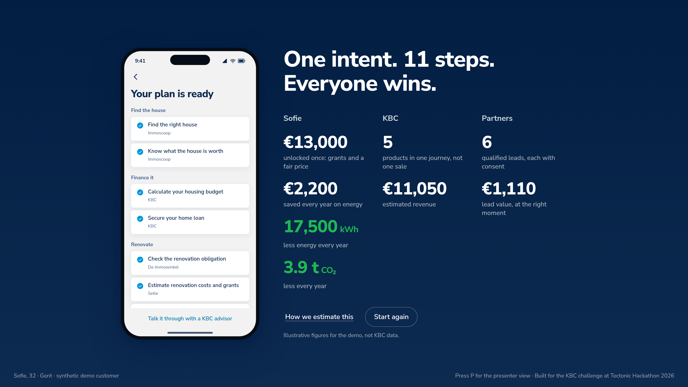
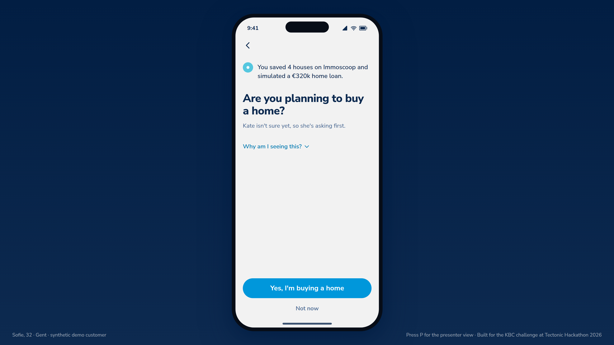
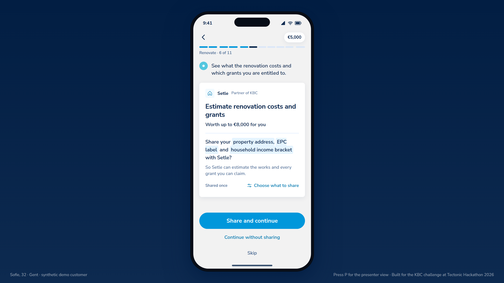

<div align="center">



**Customers don't fail because KBC lacks products. They fail because nobody turns their intent into a plan.**<br>
Kate notices a life moment, asks before assuming, and turns it into one step-by-step journey across KBC and its partners.<br>
The customer approves every step and every piece of data shared, and the plan adapts when life gets in the way.


**[→ Live demo: hackathon2026finals.vercel.app](https://hackathon2026finals.vercel.app/)**

<sub>Built for the KBC challenge at the Tectonic Hackathon 2026 finals (Gent, 20 October 2026).</sub>

</div>

---

## The problem

KBC already offers **229 products and services across 21 ecosystems**, with 28 partners (Immoscoop, Setle, Impact us today, Cambio, Billit…). That is the catalogue KBC gave us in [`resources/KBC_Ecosystems.xlsx`](resources/KBC_Ecosystems.xlsx).

For a customer, it is still a catalogue. They have to know what to look for, in which order, and from whom. The guiding question of the challenge is: *how can KBC help customers reach important goals **before they realise they need help**?*

Buying a house shows the gap well (KBC's own figures, see [`docs/assumptions.md`](docs/assumptions.md)):
- 66% of Flemish homes were built before 1981;
- the average renovation simulated with Setle costs about €48k;
- 71% of Belgians don't know which grants exist.

## What we built

**KBC Outcome Engine**: one generic pipeline that takes a customer from intent to a measurable outcome, and keeps the plan alive when reality changes.

| Step | What happens |
|---|---|
| **Signal** | Facts KBC can plausibly see: transactions, products held, and behaviour **inside** KBC Mobile (page views, loan simulations, Kate questions). 39 signal rules, with decay and saturation. |
| **Intent** | A trained model scores each life moment (buying a home, starting a business, new parent, EV, retirement). Kate then does **nothing**, **asks**, or **suggests**, and explains why. Doing nothing is always an option. |
| **Journey** | A plan composed from the KBC catalogue: 24 capabilities served by 35 catalogue items (KBC + partners such as Immoscoop, Setle, De Immowinkel, Impact us today, Billit), ordered by dependencies, with monthly payments checked against the customer's limits. |
| **Control** | Accept or skip each step; per partner and per field, the customer chooses what is shared. Nothing is shared by default. |
| **Adapt** | When something breaks the plan (income drop, quote overrun, partner delay), the engine replans and offers two costed scenarios. The customer picks; the plan gets a new version. |
| **Outcome** | A triple-win summary: what the customer, KBC and the partners each gain (estimates, labelled as such). |

Two journeys run on the **same code**: *buying and renovating a home* (14 steps, 4 chapters) and *starting a business* (9 steps, 5 chapters). A new goal means new rows (capabilities, template steps), not new code.

<div align="center">


</div>

### The model, and why it scales

- **One logistic regression per life moment**, trained on the synthetic bank (2,000 customers, 6 months of history). Cross-validated AUC 0.990–0.996. On synthetic data the model mostly re-learns the generator: the value is the pipeline, the explainability and the feedback loop, not the score.
- **Explainable by construction:** every confidence comes with its top contributions, which become Kate's *"why am I seeing this?"*.
- **Cheap:** scoring 2.5M customers × 5 moments takes about 1.2 s on one core. Only customers with new events are re-scored.
- **No language model decides anything.** Kate's LLM (optional) only rephrases an answer the engine already built, and a guard falls back to the deterministic text.

Details: [`docs/features/prediction-model.md`](docs/features/prediction-model.md), [`backend/T2-ml-model.md`](backend/T2-ml-model.md).

## Run it locally

```bash
git clone https://github.com/SimonFanna/hackathon_2026_finals.git
cd hackathon_2026_finals/web
npm install
npm run dev          # http://localhost:3000
```

| Script (in `web/`) | What it does |
|---|---|
| `npm run dev` | Development server |
| `npm run build` | Production build |
| `npm run start` | Serve the production build |
| `npm test` | Engine, backend and adapter tests (Vitest) |
| `npm run lint` | ESLint |
| `npm run snapshot` | Re-export the rules and demo facts from Supabase into the offline snapshot |

**Environment** (`web/.env.local`, see [`web/.env.example`](web/.env.example)):
- `NEXT_PUBLIC_SUPABASE_URL`, `NEXT_PUBLIC_SUPABASE_PUBLISHABLE_KEY`: read the demo customers live.
- `SUPABASE_SECRET_KEY` (server-side only, never `NEXT_PUBLIC_`): persists goals, plans and consents in Supabase. Without it, state is kept in memory.
- `BACKEND_OFFLINE=1`: forces the bundled snapshot (demo without network).
- `KATE_LLM_API_KEY` (optional, server-side only): lets Kate rephrase. Without it she uses her deterministic answers.

**No variable at all still works:** the backend runs on the bundled snapshot, and if the API is unreachable the UI falls back to its local engine.

**Data (optional):** the synthetic bank and the model weights can be regenerated and loaded:
```bash
python3 scripts/bank_data/generate.py                                    # 2,000 customers → CSVs
psql "$DATABASE_URL" -v ON_ERROR_STOP=1 -f scripts/bank_data/load.sql     # load them (from the repo root)
psql "$DATABASE_URL" -v ON_ERROR_STOP=1 -f supabase/seed/model_weights.sql
```

### Demo controls (presenter)

| Key | Action |
|---|---|
| `1` / `2` / `3` | On the players screen: Lina (business), Thomas (home), or "your own" customer |
| `→` / `Enter` | Next (the main action of the current screen) |
| `←` | Back |
| `S` | Skip the step (or "Not now" on the question screen) |
| `F` | Add every remaining step and show the plan |
| `Esc` | Dismiss Kate's notification |
| `R` / `C` | Restart / back to the players |
| `P` | Presenter panel: signals, confidence level, catalogue item, raw scoreboard |
| `W` | With the panel open: weak signals, so Kate stays silent (no action) |

Backup links: `/?player=house|business`, `/?demo=intent`, `/?demo=step&n=6`, `/?demo=live`, `/?demo=event&n=2`, `/?demo=finale`, `/?demo=weak`.

In the UI the players are called Thomas (home) and Lina (business). Behind them, the backend uses the synthetic bank customers Sofie and Lucas. The footer says whether a screen comes from the **live engine** or the **offline engine**.

## Architecture

```
web/                         Next.js 16 + TypeScript + Tailwind v4
  src/backend/               KBC Outcome Engine (pure, deterministic, Vitest)
    engine/                    events → signals → context → ML moments → intents → decision
                               → registry → plan → rules → consent → outcome → disruption → replan → Kate
    data/                      Supabase loaders + offline snapshot, runtime repo (Supabase or memory)
    pipeline.ts, service.ts    runPipeline(slug) and the use cases behind the API
  src/app/api/               13 routes (customers, pipeline, goals, steps, consents, events, scenarios, kate), zod-validated
  src/lib/backend.ts         UI ↔ API adapter (never throws: null → the UI keeps its local engine)
  src/engine/                local engine used by the UI as a fallback and for the scripted surprises
  src/components/            phone stage, screens, consent sheets, presenter panel, 3D picker
supabase/migrations/         catalogue, synthetic bank, rules and config tables, runtime tables (RLS on everywhere)
supabase/seed/               catalogue, capabilities, model weights
scripts/bank_data/           synthetic bank generator (deterministic) + psql loader
scripts/ml/                  feature export, training (scikit-learn), benchmark
backend/                     design (backend.md), task split (TASKS.md, T1–T8), review (REVIEW.md)
docs/features/               one file per feature
docs/assumptions.md          every demo figure with its source or "estimate"
SOLUTION.md                  the idea, decisions and timestamped log
```

## Data and security

- **100% synthetic customers.** A generated bank of 2,000 customers (transactions, loans, products, children, in-app events). IBANs, VAT numbers and emails are deliberately invalid, so none can belong to a real person. The only external data is KBC's catalogue (XLSX). € / kWh / CO₂ values are illustrative estimates, and the UI says so.
- **Supabase:** RLS on every table. Public roles can read only the 6 demo customers and the read-only config. Runtime tables have no public access, and the model's ground truth lives in a private `ml` schema. Keys live in environment variables, never in git.
- **API:** zod validation on every body and parameter, demo customers only, generic errors, same-origin check and rate limit on writes, bounded what-if values.
- **HTTP hardening:** strict CSP, `frame-ancestors 'none'`, `nosniff`, Referrer and Permissions policies, HSTS in production.
- **Review and scan:** a multi-agent review of the backend is in [`backend/REVIEW.md`](backend/REVIEW.md); Aikido notes are in [`docs/features/security.md`](docs/features/security.md). The only `npm audit` finding is a dev-only ESLint dependency (`braces`) with no patched version; production dependencies report 0.

## Status: what is done, what is not

| Part | State |
|---|---|
| Synthetic bank in Supabase (2,000 customers, RLS) | Done |
| Signals and context (T1), trained moment model (T2) | Done |
| Moments, intents and decision gate (T3) | Done |
| Capability registry and goal templates (T4): home + business | Done; baby, EV and retirement templates not built |
| Plan, consent, outcome tracker (T5) | Done |
| Disruption, replanning, scenarios A/B (T6) | Done |
| Data layer, API, offline snapshot (T7) | Done |
| Kate: proactive message, plan Q&A, scenario choice (T8) | Done; Q&A still reads a fixed plan, not the live one |
| UI wired to the backend (intent, plan, consents, outcome, replanning) | Done, with local fallback; the rate-rise and business surprises stay scripted |
| Live URL (Vercel) | Deployed |
| Pitch deck (PPT/PDF, 3 min) | In progress |

## Team

Four teammates and their coding agents, working in parallel on this repo (rules in [`CLAUDE.md`](CLAUDE.md)):
- **Kepa:** coordination, UI, local engine;
- **Simon:** synthetic bank and Supabase, signals and ML model (T1–T2), registry and API (T4, T7), UI ↔ backend wiring;
- **Mathias:** backend design, decision, planning, replanning and Kate (T3, T5, T6, T8);
- **Victor:** app and 3D experience.

## Notes

- KBC branding (KBC Design Language tokens, logo) is used for the KBC challenge only.
- KBC's typeface, Museo Sans, is commercial and is never committed. Nunito Sans is the stand-in.
- All amounts are illustrative estimates, not KBC rates or offers.
